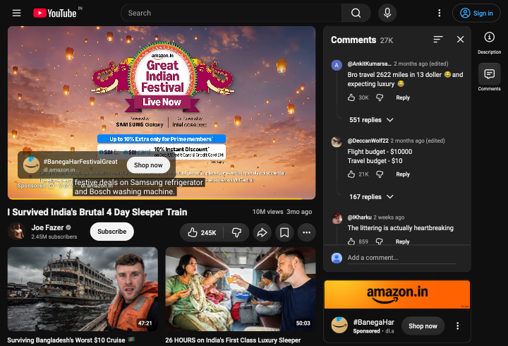

# YouTube ad investigation

9 October 2026; signed-out WebKit test windows using Paper's `WebKitSession`, nonpersistent storage, and active bundled/cached blocker. This is a live-site sample, not a claim that all YouTube ad formats behave alike. The opt-in, read-only `YouTubeInvestigationTests` test can capture player structure again; it runs only when `/private/tmp/paper-run-youtube-investigation` exists. It records structural counts, playback state, and a screenshot in XCTest attachments, without credentials or full request URLs.

## Observed behavior

1. The public 19-second “Me at the zoo” video played normally. Its initial player response exposed streaming and video details, but no `adPlacements`, `playerAds`, or `adSlots` arrays in the sampled page state.
2. Autoplay then opened a different public video. A sponsored pre-roll appeared while the *same* HTML `<video>` element was reused. The active player response exposed `playerAds`, `adPlacements`, and `adSlots`; a `/youtubei/v1/player` response contained 7 placements, 6 slots, and 1 player-ad entry in one sample. The player used both `googlevideo.com` and ad-related hosts. This does not establish that blocking any one host is safe.
3. Loading that second public video directly reproduced a pre-roll. The unmodified control showed `ad-showing` at 6, 13, 20, 26, and 32 seconds; at 26 seconds a second ad had begun. The screenshot below shows the sponsored player. No normal video frame had been observed by the 32-second sample.

No mid-roll, Shorts ad, signed-in case, anti-adblock notice, or login restriction was verified. The existing WebKit rule API gives Paper no per-request match count, so we cannot say which standard rule fired. The first-party player response carrying ad metadata is outside Paper's third-party-only rule conversion. CSS hiding can address some banners but cannot by itself replace a playing video ad.

## Test-only experiments and decision

The experiments were confined to the diagnostic test and removed from its final source. They targeted only the exact `/youtubei/v1/player` path and/or `ytInitialPlayerResponse`, and only the array fields `adPlacements`, `playerAds`, and `adSlots` when normal `streamingData` and `videoDetails` existed. Normal media URLs and authentication data were not changed.

| Experiment | Observed result on the directly loaded video |
| --- | --- |
| Read-only control | Two pre-roll ads played; normal video had not started by 32 seconds. |
| Prune player `fetch` response only | A pre-roll still played. The initial in-page response retained ad fields. |
| Prune initial in-page response and player `fetch` response | No visible ad in one run, but normal video remained at `readyState = 0` through 26 seconds; it advanced to about 5.7 seconds by the 32-second sample. |
| Prune initial in-page response only | Same qualitative delay: no visible ad, `readyState = 0` through 26 seconds, and normal playback advanced to about 5.5 seconds by 32 seconds. |

The fetch-only approach was ineffective. Initial-response pruning correlated with a roughly 26-second start delay in both runs, likely related to YouTube's player/ad scheduling; the exact cause was not established. Removing more fields or blocking `googlevideo.com` would increase breakage risk without evidence of reliable benefit. **No YouTube-specific runtime mitigation is shipped.** The current blocker, cosmetic filtering, and per-site bypass remain available.

These are single live runs on a macOS 27.2 beta MacBook Air, not controlled latency distributions. CPU impact, time to first *normal* frame in the control, mid-roll handling, signed-in playback, route changes, seeking, captions, fullscreen, picture-in-picture, and false-positive rates were not measured. Multiple real-video manual checks and hardware playback review remain necessary before reconsidering a runtime layer.
